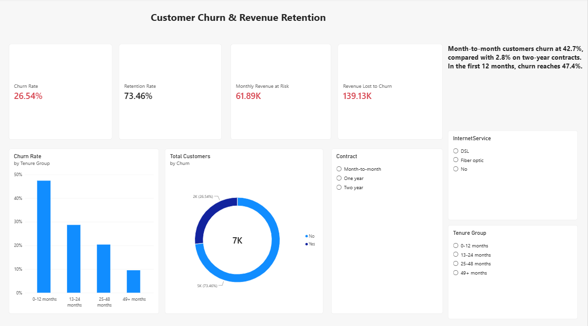
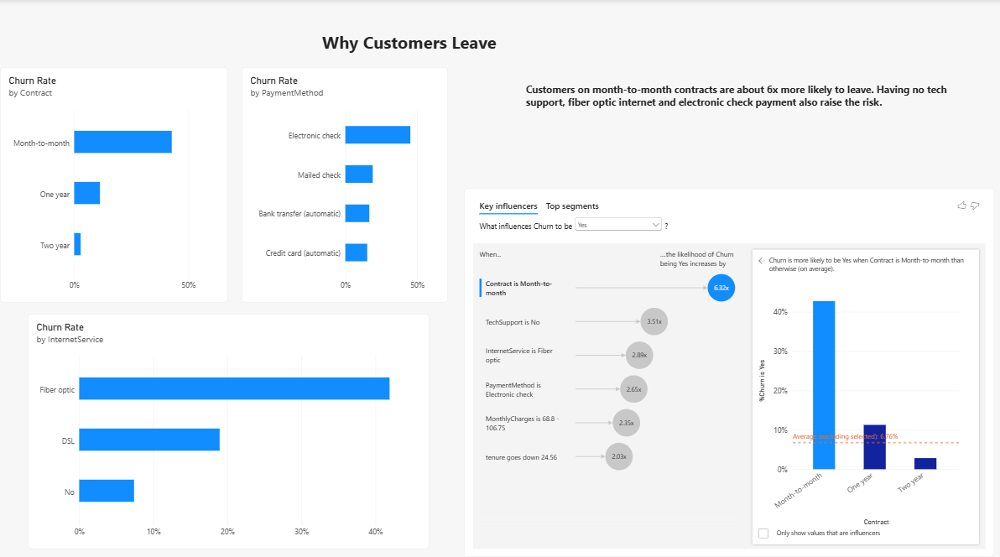
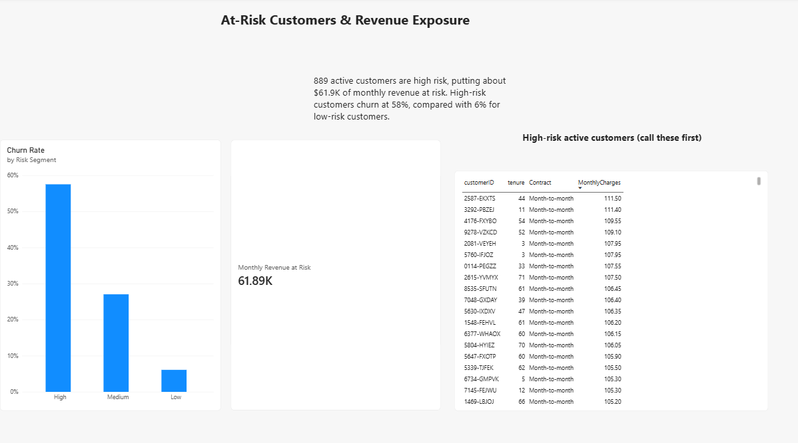

# Customer Churn & Revenue Retention Dashboard

A three-page Power BI dashboard built on 7,043 telecom customers to find out why customers leave, which segments are most at risk, and how much monthly revenue is exposed to churn.

## Key results
- **26.5% churn rate** (1,869 customers), costing about **$139K in monthly revenue**
- **889 active customers are high risk**, putting about **$61.9K of monthly revenue** at risk
- Month-to-month customers churn at **42.7%**, compared with 2.8% on two-year contracts
- Churn reaches **47.4%** in the first 12 months
- Risk score check: high-risk customers churn at **58%**, medium at **27%**, low at **6%**

## Why customers leave
Power BI's Key Influencers analysis ranked these factors by how much more likely they make a customer to churn:
- Month-to-month contract: 6.3x
- No tech support: 3.5x
- Fiber optic internet: 2.9x
- Electronic check payment: 2.7x

## Dashboard pages

### 1. Executive Overview
Churn rate, retention rate, revenue lost to churn and revenue at risk, with churn by tenure group and slicers for contract, internet service and tenure group.

### 2. Why Customers Leave
Churn by contract, payment method and internet service, plus the Key Influencers analysis.

### 3. At-Risk Customers
Churn by risk segment and a list of the 889 active high-risk customers, sorted by monthly charge, for a retention team to contact.

## How I built it
- **Power Query:** fixed data types, converted SeniorCitizen to Yes/No, handled blank TotalCharges values
- **DAX:** measures for churn rate, retention rate, revenue lost and revenue at risk, plus calculated columns for tenure group and a rule-based risk score
- **Power BI visuals:** cards, column and bar charts, donut chart, slicers, Key Influencers and a filtered table

## Recommendations
- Offer incentives to move month-to-month customers onto one- or two-year contracts
- Focus onboarding on the first 12 months
- Promote tech support to customers who don't have it
- Encourage a move from electronic check to automatic payment
- Contact the highest-paying high-risk customers first

## Limitations
The risk score weights are a judgment call checked against actual churn, not a trained prediction model. The dataset has no dates, so churn is analysed by tenure group rather than as a monthly trend.

## Files in this repository
- `Churn Desktop v2.pbix`: the Power BI dashboard
- `Churn Dashboard new.pdf`: a PDF export of all three pages
- `WA_Fn-UseC_-Telco-Customer-Churn.csv`: the dataset
- `page1-overview.png`, `page2-why-customers-leave.png`, `page3-at-risk.png`: dashboard screenshots

## Data source
IBM Telco Customer Churn sample dataset (available on Kaggle).

## Author
Sibna KS | sibnasenaj@gmail.com
